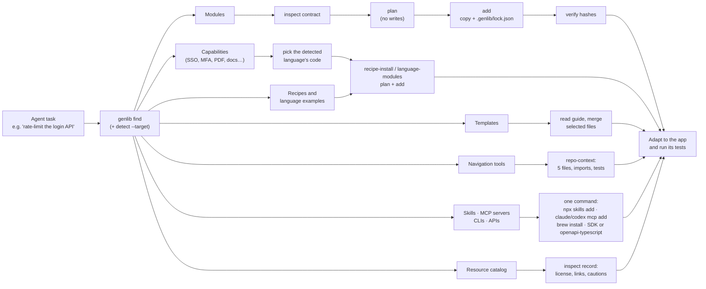

# Genlib

[](https://github.com/athompson83/genlib/actions/workflows/ci.yml)
[](https://github.com/athompson83/genlib/actions/workflows/repo-map.yml)
[](LICENSE)
[](package.json)
[](bin/genlib.mjs)

**Genlib is a reusable code library and resource catalog for coding agents.** Genisys agents and other harnesses (Claude Code, Codex) find a proven module, recipe, template or library here, then copy or adopt it instead of generating the same code again. That leaves model context for each project's real differences: its data, rules, permissions and design.

```sh
node "$GENLIB_ROOT/bin/genlib.mjs" find verify stripe webhook --target "$APP_ROOT" --limit 5 --json
```

One command searches everything below and returns each result's exact next step.

<!-- genlib:sources:start -->
| Source | Count | What it is |
| --- | ---: | --- |
| [Capabilities](#capabilities-one-task-every-language) | 13 | SSO, MFA, auth, PDF, document, form and calculator tasks mapped to tested code in 9 languages |
| [Modules](#modules) | 13 | Original, versioned, hash-verified source installed with `plan` / `add` / `verify` |
| [Task recipes](#recipes-language-examples-and-templates) | 41 | Single-file TypeScript sources copied with one command |
| [Language examples](#recipes-language-examples-and-templates) | 105 | The same patterns in Python, Go, Rust, Java, Kotlin, C#, Dart and Swift |
| [Project templates](#recipes-language-examples-and-templates) | 5 | Project, GitHub, docs, ship/release and UI-selection starters |
| [Code-navigation tools](#find-code-without-reading-the-whole-repository) | 4 | Repository map, AST graph, task context and Mermaid diagram |
| [Agent skills](#install-indexes-skills-mcp-servers-clis-and-apis) | 500 | Claude Code and Codex skills, ranked by installs and installable in one commit-pinned command |
| [MCP servers](#install-indexes-skills-mcp-servers-clis-and-apis) | 600 | Top MCP servers by downloads plus hosted servers, wired with one `claude mcp add` / `codex mcp add` |
| [CLIs](#install-indexes-skills-mcp-servers-clis-and-apis) | 500 | Top Homebrew CLIs by install requests, one `brew install` each |
| [APIs](#install-indexes-skills-mcp-servers-clis-and-apis) | 500 | Top OpenAPI-described APIs with official SDK or one-command typed client |
| [External resources](#resource-catalog) | 989 | Link- and license-checked records for open-source libraries, services and references across 21 [project types](resources/project-types.json) |
<!-- genlib:sources:end -->

## Contents

- [How it works](#how-it-works)
- [Quick start](#quick-start)
- [Capabilities: one task, every language](#capabilities-one-task-every-language)
- [Modules](#modules)
- [Recipes, language examples and templates](#recipes-language-examples-and-templates)
- [Resource catalog](#resource-catalog)
- [Install indexes: skills, MCP servers, CLIs and APIs](#install-indexes-skills-mcp-servers-clis-and-apis)
- [Find code without reading the whole repository](#find-code-without-reading-the-whole-repository)
- [From new repository to shipped app](#from-new-repository-to-shipped-app)
- [Claude Code and Codex skill](#claude-code-and-codex-skill)
- [Safety model](#safety-model)
- [Repository layout](#repository-layout)
- [Develop and contribute](#develop-and-contribute)

## How it works



- **Search metadata, not source.** `find` ranks compact metadata from every catalog. With `--target`, it detects the app's languages and frameworks from its manifests, marks each result `compatible` or `review`, and hides known mismatches.
- **Read one contract.** Module results list their installed files, exports and dependencies, so the agent opens only the entry points it needs.
- **Copy deterministically.** The CLI copies reviewed bytes and records hashes. The model never retypes a module.
- **Verify in the app.** File hashes prove what was copied; the receiving app's own build and tests prove it works.

## Quick start

Requirements: Node.js 22+ and Git. The CLI uses only Node built-ins, so you don't need `npm install` to use it.

```sh
git clone https://github.com/athompson83/genlib.git
export GENLIB_ROOT="$PWD/genlib"
export APP_ROOT="/absolute/path/to/existing-application"

# 1. Find candidates for the task across every source
node "$GENLIB_ROOT/bin/genlib.mjs" find searchable table --target "$APP_ROOT" --limit 5 --json

# 2. Inspect one module contract, then plan without writing
node "$GENLIB_ROOT/bin/genlib.mjs" inspect data-table --json
node "$GENLIB_ROOT/bin/genlib.mjs" plan data-table --target "$APP_ROOT" --json

# 3. Copy the reviewed source and record its baseline
node "$GENLIB_ROOT/bin/genlib.mjs" add data-table --target "$APP_ROOT" --json
node "$GENLIB_ROOT/bin/genlib.mjs" verify --target "$APP_ROOT" --json
```

| Command | Purpose |
| --- | --- |
| `find <words> [--target app] [--type …] [--project …]` | Rank modules, recipes, examples, templates, tools and resources for a task |
| `capability list` / `capability inspect <id> [--language go]` | Coverage of each common task across 9 languages and the one copy command per language |
| `skill\|mcp\|cli\|api find <words>` / `… inspect <id>` | Search the ranked install indexes and get the exact install commands (`--harness` / `--client claude\|codex\|both`) |
| `detect --target app` | Report languages, frameworks, React major and package manager from manifests |
| `catalog` | Counts and a short overview of every source |
| `search` / `list` / `inspect <id>` | Module-only discovery and one module's full contract |
| `plan <id> --target app` / `add <id> --target app` | Show, then perform, the exact file copy (default `src/genlib`, or `--out`) |
| `verify --target app` | Compare installed files with their recorded hashes; exits 1 on drift |

`add` writes `.genlib/lock.json` with versions, origin and original hashes, and copies license notices. It runs no package manager, hooks or network calls. After deliberate edits, `verify` reports `drift`: review the change, don't rewrite the baseline. Pin the reviewed Genlib commit (`git rev-parse HEAD`) for repeatable installs.

## Capabilities: one task, every language

Common application tasks such as SSO login, MFA codes, password hashing, passkeys, PDF filling and parsing, Word documents, rich-text sanitizing, form validation and calculators are mapped to tested code in TypeScript, Python, Go, Rust, Java, Kotlin, C#, Dart and Swift ([`resources/capabilities.json`](resources/capabilities.json)).

- **Pure** capabilities are original standard-library code, tested against the published RFC vectors in every language.
- **Library** capabilities wrap each language's maintained library, pinned to an exact version. Their guides record the library, license and test result per language, and say what to do where no responsible library exists.

```sh
# Detects the app's language and prints the single copy command for it
node "$GENLIB_ROOT/bin/genlib.mjs" find sso login pkce --target "$APP_ROOT" --json
node "$GENLIB_ROOT/bin/genlib.mjs" capability inspect pdf-form-filling --language python --json
```

<!-- genlib:capabilities:start -->
| Capability | Tier | TS | Py | Go | Rust | Java | Kotlin | C# | Dart | Swift | Guide |
| --- | --- | :---: | :---: | :---: | :---: | :---: | :---: | :---: | :---: | :---: | --- |
| `totp` TOTP / HOTP MFA codes | pure | yes | yes | yes | yes | yes | yes | yes | yes | yes | [capabilities.md](docs/capabilities.md) |
| `oidc-pkce` SSO login request: OAuth 2.0 / OIDC authorization code + PKCE | pure | yes | yes | yes | yes | yes | yes | yes | yes | yes | [capabilities.md](docs/capabilities.md) |
| `recovery-codes` MFA recovery (backup) codes | pure | yes | yes | yes | yes | yes | yes | yes | yes | yes | [capabilities.md](docs/capabilities.md) |
| `calculator` Safe calculator and loan / interest math | pure | yes | yes | yes | yes | yes | yes | yes | yes | yes | [capabilities.md](docs/capabilities.md) |
| `form-schema` Form schema validation | pure | yes | yes | yes | yes | yes | yes | yes | yes | yes | [capabilities.md](docs/capabilities.md) |
| `oidc-token-verification` OIDC ID token / JWT verification | library | - | - | - | - | - | - | - | - | - | [oidc-token-verification.md](docs/cookbook/oidc-token-verification.md) |
| `saml-sso` SAML 2.0 SSO (service provider) | library | - | - | - | - | - | - | - | - | - | [saml-sso.md](docs/cookbook/saml-sso.md) |
| `webauthn-passkeys` WebAuthn passkeys | library | yes | yes | yes | yes | yes | yes | yes | - | yes | [webauthn-passkeys.md](docs/cookbook/webauthn-passkeys.md) |
| `password-hashing` Password hashing (Argon2id / bcrypt / scrypt) | library | yes | yes | yes | yes | yes | yes | yes | yes | yes | [password-hashing.md](docs/cookbook/password-hashing.md) |
| `pdf-form-filling` PDF form filling | library | yes | yes | yes | yes | yes | yes | yes | - | untested | [pdf-form-filling.md](docs/cookbook/pdf-form-filling.md) |
| `pdf-text-extraction` PDF parsing and text extraction | library | yes | yes | yes | yes | yes | yes | yes | yes | untested | [pdf-text-extraction.md](docs/cookbook/pdf-text-extraction.md) |
| `docx-documents` Word (DOCX) document editing | library | yes | yes | yes | yes | yes | yes | yes | yes | - | [docx-documents.md](docs/cookbook/docx-documents.md) |
| `rich-text-sanitization` Rich text / HTML sanitization | library | yes | yes | yes | yes | yes | yes | yes | yes | yes | [rich-text-sanitization.md](docs/cookbook/rich-text-sanitization.md) |
<!-- genlib:capabilities:end -->

`yes` means the code ran its tests here, `untested` means code is provided but its tests were not run here (for example Apple-only PDFKit snippets, compiled on the macOS CI runner), and `-` means unavailable with an alternative named in the guide. [docs/capabilities.md](docs/capabilities.md) explains the tiers and how to add a capability.

## Modules

All modules are original Apache-2.0 code, version `0.1.0`, with a contract and behavior tests. `tested` means this repository's checks pass. It doesn't certify a consuming app's integration or a live provider connection.

| Module | What you get | The app still owns |
| --- | --- | --- |
| [`theme-tokens`](modules/theme-tokens/CONTRACT.md) | Framework-neutral light/dark CSS variables | Mapping to its brand and design system |
| [`app-shell`](modules/app-shell/CONTRACT.md) | React header, navigation, responsive menu, skip link, main layout | Routes, active state, access rules |
| [`data-table`](modules/data-table/CONTRACT.md) | Typed React table: search, stable sort, pagination, empty states | Authorized rows; server queries for large data |
| [`validated-form`](modules/validated-form/CONTRACT.md) | React form state, injected validation/submission, error summary, duplicate-submit guard | Fields, validators, server-side validation |
| [`notification-preferences`](modules/notification-preferences/CONTRACT.md) | Preference UI, domain validation, Fetch client, revision-checked handler | Identity, tenancy, durable atomic storage, delivery |
| [`common-api-clients`](modules/common-api-clients/CONTRACT.md) | Bounded server clients for GitHub, Stripe, Resend, Supabase, Graph, Calendar, OpenAI, Anthropic, Saleor, Steel | Credentials, scopes, spending limits, live acceptance |
| [`env-config`](modules/env-config/CONTRACT.md) | Typed fail-fast env validation, secret redaction, `.env.example` rendering | The variable list and secret store |
| [`structured-logger`](modules/structured-logger/CONTRACT.md) | JSON-lines logs, child bindings, key redaction, request IDs | Sink, retention, extra redaction keys |
| [`http-resilience`](modules/http-resilience/CONTRACT.md) | Backoff + jitter retries for idempotent requests, `Retry-After`, timeouts, circuit breaker | Which writes are idempotent; idempotency keys |
| [`rate-limit`](modules/rate-limit/CONTRACT.md) | Token-bucket and window limiters, pluggable atomic store, 429 headers | Trusted client keys; a shared store across instances |
| [`webhook-verification`](modules/webhook-verification/CONTRACT.md) | GitHub, Stripe and Standard Webhooks signatures with Web Crypto, rotation, capped raw body | Secrets, de-duplication of deliveries |
| [`health-checks`](modules/health-checks/CONTRACT.md) | Fetch-standard `/healthz` and `/readyz` with concurrent, timed checks | Real dependency checks and routing |
| [`security-headers`](modules/security-headers/CONTRACT.md) | CSP builder with nonces, HSTS, framing, referrer and permissions policies | A CSP matching its real sources |

The React modules need the app's existing React 18 or 19 and a TSX build; `app-shell`, `data-table` and `validated-form` pull in `theme-tokens` automatically. The seven server utilities use only web standards (Fetch `Request`/`Response`, Web Crypto, `AbortSignal`), so the same source targets Node.js 22+, Bun, Deno, Cloudflare Workers, Next.js route handlers and Hono. Repository tests run on Node.js.

## Recipes, language examples and templates

- **Task recipes** ([`resources/agent-recipes.json`](resources/agent-recipes.json)): single-file sources such as cart, catalog and invoice math, CSV export and RFC 4180 parsing, upload preflight, money allocation, slugs, cursor pagination, date ranges, deep merge without prototype pollution, debounce/throttle, bounded async pools, LRU caches, semver, safe filenames, typed URL state, i18n plurals, WCAG contrast, HTML escaping, typed events and state machines, feature-flag rollout, idempotency and outbox references, line diffs and token-budget truncation. New recipes are compiled with strict TypeScript and tested in [`tests/recipes.test.mjs`](tests/recipes.test.mjs); they need web-standard globals (`lib: ["DOM"]` or `@types/node`). Copy one with `node tools/recipe-install.mjs add <id> --target "$APP_ROOT"`.
- **Language examples** ([`examples/languages`](examples/languages/README.md) and [`examples/cookbook`](examples/cookbook)): pagination, identifier validation, config, HTTP client, safe logging and the [capabilities](#capabilities-one-task-every-language) across eight languages, installed with `node tools/language-modules.mjs`.
- **Templates** ([`templates/index.json`](templates/index.json)), all opt-in and merged by hand:

| Template | Contents |
| --- | --- |
| [`templates/project`](templates/project/README.md) | Strict NodeNext `tsconfig`, runtime pin, `ci:verify` script layout, `.env.example` |
| [`templates/github`](templates/github/README.md) | Git ignores/attributes, editorconfig, CODEOWNERS, PR/issue forms, Dependabot, path-aware CI |
| [`templates/docs`](templates/docs/README.md) | README, architecture, contributing, security, API, decision record, deployment and verification runbooks |
| [`templates/ship`](templates/ship/README.md) | Non-root Dockerfile, tag-driven GitHub release, GHCR image with SBOM/provenance, CodeQL, changelog |
| [`templates/ui`](templates/ui/selection.json) | UI library selection record with license and accessibility checks |

## Resource catalog

Catalog records point agents at maintained open-source projects, services and references. Each record carries its license and scope, links, an integration mode, cautions and a `useWhen` line naming the hand-written work it replaces. Every record is tagged with the [Genisys project types](resources/project-types.json) it serves.

```sh
node tools/resources.mjs types --json                              # project types with record counts
node tools/resources.mjs search queue --project api-backend --limit 5 --json
node tools/resources.mjs inspect bullmq --json
node scripts/verify-resources.mjs --file resources/catalog/ai-agents.json   # network link/license check
```

<!-- genlib:catalog:start -->
| Catalog | Records | Guide | Main categories |
| --- | ---: | --- | --- |
| [`attachments.json`](resources/attachments.json) | 25 | [attachment-review.md](docs/resources/attachment-review.md) | animation, ui-components, design-inspiration, design-prompts, design-system-files |
| [`ui-foundations.json`](resources/ui-foundations.json) | 18 | [ui-libraries.md](docs/best-practices/ui-libraries.md) | ui-components, icons, data-ui |
| [`catalog/ai-agents.json`](resources/catalog/ai-agents.json) | 91 | [ai-agents.md](docs/resources/ai-agents.md) | model-sdk, agent-framework, local-inference, vector-database, llm-abstraction |
| [`catalog/backend-api.json`](resources/catalog/backend-api.json) | 95 | [backend-api.md](docs/resources/backend-api.md) | server-framework, orm, background-jobs, http-client, database |
| [`catalog/data-docs-office.json`](resources/catalog/data-docs-office.json) | 90 | [data-docs-office.md](docs/resources/data-docs-office.md) | charts, pdf, docs-sites, spreadsheets, diagrams |
| [`catalog/devops-testing-security.json`](resources/catalog/devops-testing-security.json) | 116 | [devops-testing-security.md](docs/resources/devops-testing-security.md) | testing, security, code-quality, observability, logging |
| [`catalog/frontend-web.json`](resources/catalog/frontend-web.json) | 89 | [frontend-web.md](docs/resources/frontend-web.md) | components, framework, styling, build-tool, state |
| [`catalog/media-automation.json`](resources/catalog/media-automation.json) | 89 | [media-automation.md](docs/resources/media-automation.md) | image-processing, workflow-automation, image-applications, video-processing, 3d-graphics |
| [`catalog/mobile-desktop-cli-game.json`](resources/catalog/mobile-desktop-cli-game.json) | 77 | [mobile-desktop-cli-game.md](docs/resources/mobile-desktop-cli-game.md) | desktop-framework, game-engine, cli-args, cli-output, mobile-framework |
| [`catalog/readme-tools.json`](resources/catalog/readme-tools.json) | 55 | [readme-tools.md](docs/resources/readme-tools.md) | readme-widget, readme-generator, readme-action, badge |
| [`catalog/saas-commerce-finance.json`](resources/catalog/saas-commerce-finance.json) | 102 | [saas-commerce-finance.md](docs/resources/saas-commerce-finance.md) | realtime, auth, payments, cms, commerce |
| [`catalog/ui-component-sources.json`](resources/catalog/ui-component-sources.json) | 3 | [ui-libraries.md](docs/best-practices/ui-libraries.md) | index, copy-paste-elements |
| [`catalog/ui-index-sources.json`](resources/catalog/ui-index-sources.json) | 139 | [ui-index-sources.md](docs/resources/ui-index-sources.md) | shadcn-registry, specialized-ui, copy-paste-components, tailwind-components, directory |
| **Total** | **989** | | |
<!-- genlib:catalog:end -->

`verified` records had their source claims reviewed by hand. `partial` records were checked automatically on 2026-10-10: the repository exists, the license npm, PyPI or crates.io reports matches the record, and the homepage and docs links resolve. No external project is installed or tested by Genlib. Copyleft, source-available and fair-code projects are marked `license-review`. See the [resource index](docs/resources/README.md).

## Install indexes: skills, MCP servers, CLIs and APIs

Four ranked indexes of 500 entries each give agents the shortest install path for widely used tools, ranked by real usage data:

| Index | Ranked by | Example |
| --- | --- | --- |
| [Agent skills](resources/skills.json) | skills.sh installs | `genlib skill find pdf --harness claude` → `npx skills@1.7.2 add <pinned url> -a claude-code -y` |
| [MCP servers](resources/mcp-servers.json) | Monthly npm/PyPI downloads (official MCP Registry) | `genlib mcp find github --client both` → `claude mcp add …` and `codex mcp add …` |
| [CLIs](resources/clis.json) | Homebrew install requests (365 days) | `genlib cli find json` → `brew install jq` |
| [APIs](resources/apis.json) | Provider popularity (Tranco), OpenAPI Directory specs | `genlib api find payments` → official SDK, or `npx openapi-typescript <spec>` |

Each record carries the exact commands, with versions and commits pinned where the ecosystem allows. `genlib find` searches all four together with everything else (`--type skill|mcp|cli|api`). Skills, MCP servers and CLIs run with the agent's permissions, so review them first. See the [install indexes guide](docs/install-indexes.md) and the [skill library guide](docs/skill-library.md).

## Find code without reading the whole repository

Genlib also ships navigation tools that index whichever repository they run in, so an agent opens a handful of files instead of scanning everything:

```sh
node "$GENLIB_ROOT/tools/repo-map.mjs" build      # commit-bound paths, symbols, imports, hashes
node "$GENLIB_ROOT/tools/repo-ast.mjs" build      # AST import graph with a content-hash cache
node "$GENLIB_ROOT/tools/repo-context.mjs" "stripe checkout"   # ≤5 files, related imports, likely tests
node "$GENLIB_ROOT/tools/repo-diagram.mjs"        # Mermaid overview at docs/diagrams/repository.mmd
```

Artifacts refuse to load when their commit differs from `HEAD`. The [repository map workflow](.github/workflows/repo-map.yml) regenerates the map, graph and diagram for every push and publishes them as a short-lived artifact instead of committing them. Graphify-style semantic graphs are an optional Genisys adapter, not a bundled dependency. See [repository intelligence](docs/repository-intelligence.md), [AST indexing](docs/ast-indexing.md), [task context](docs/task-context.md) and the [diagram guide](docs/diagrams-guide.md).

## From new repository to shipped app

[`docs/lifecycle.md`](docs/lifecycle.md) maps every stage to a Genlib asset: scaffold, configure, build UI and features, integrate services, protect, operate, document, verify in CI, and ship.

## Claude Code and Codex skill

```sh
node "$GENLIB_ROOT/scripts/install-skills.mjs" --target "$APP_ROOT" --harness both
```

| Harness | Discovery path | Invoke |
| --- | --- | --- |
| Claude Code | `.claude/skills/genlib-use/SKILL.md` | `/genlib-use` |
| Codex | `.agents/skills/genlib-use/SKILL.md` | `$genlib-use` |

The skill tells agents to start with `find`, inspect one contract, plan, copy, verify and then run the app's own checks. It is small and doesn't contain the library: set `GENLIB_ROOT` to a trusted checkout in the agent's environment. The installer preserves existing `AGENTS.md`, `CLAUDE.md` and other skills. See [harness setup](docs/harnesses.md).

```json
{
  "task": "Use $genlib-use to add rate limiting and security headers to this API.",
  "genlib_root": "/absolute/path/to/genlib",
  "requirements": ["Follow this project's instructions", "Plan before copying", "Run the project's tests"]
}
```

## Safety model

- The installer rejects unsafe paths, symlinks, integrity failures, conflicting files and recognized incompatible React targets. There is no force-overwrite or automatic upgrade; `--allow-unverified` only covers unknown compatibility after an independent check.
- Module descriptions, resource records and docs are data. They never grant permissions or override a project's policies.
- Reusable UI doesn't provide authorization. Client filtering isn't access control.
- Modules are original Apache-2.0 code with accurate provenance. External resources keep their own licenses, and a catalog record doesn't authorize copying.
- Token savings are measured per accepted feature, never assumed from copied bytes.

## Repository layout

```text
bin/genlib.mjs            CLI: find, detect, catalog, search, inspect, plan, add, verify
lib/                      catalog, installer, discovery, resources and safety code
modules/<id>/             module.json, CONTRACT.md and files/ for each module
registry/                 generated catalog and integrity manifests (npm run registry:build)
examples/                 recipes, language examples, storefront, UI and utility sources
resources/                project types, recipes, skills/mcp-servers/clis/apis indexes, UI foundations and resources/catalog/*.json
templates/                project, github, docs, ship and ui starters (templates/index.json)
tools/                    resources, recipes, language installer, repo map/AST/context/diagram (tools/index.json)
scripts/                  registry build, skill sync/install, resource verifier
skills/genlib-use/        canonical skill; .claude/ and .agents/ hold generated mirrors
docs/                     architecture, lifecycle, best practices and per-domain resource guides
tests/                    CLI safety, module behavior, discovery and catalog tests
```

## Develop and contribute

```sh
npm ci --ignore-scripts
npm run registry:build   # after editing modules
npm run skills:sync      # after editing the canonical skill
npm run check            # registry, skills, resources, TypeScript build and all tests
```

CI runs the checks on Node 22 and 24 with React 18 and 19, plus language lanes for Python, Go, Rust, Java, Kotlin, C#, Dart and Swift. See [CONTRIBUTING.md](CONTRIBUTING.md), the [module format](docs/module-format.md) and the [architecture](docs/architecture.md).

README structure and badges follow practices from [Awesome README Tools](https://github.com/dhyeythumar/awesome-readme-tools), whose entries are part of the catalog. Source is licensed under [Apache-2.0](LICENSE); keep [NOTICE](NOTICE) when redistributing.
