# Architecture

Genlib distributes editable source to an existing application. It is not an application runtime, hosted service, or authority system. The library uses original Apache-2.0 code with explicit contracts for React/TypeScript web modules, framework-neutral theme tokens and server-only TypeScript API clients.

## System overview

<picture>
  <source media="(prefers-color-scheme: dark)" srcset="diagrams/architecture-dark.svg">
  
</picture>

Diagram source (Mermaid: edit this, then run <code>npm run diagrams:render</code>)

```mermaid
flowchart TB
  subgraph Authored["Authored sources (reviewed in Git)"]
    MOD["modules/{id}/<br/>module.json · CONTRACT.md · files/"]
    REC["resources/agent-recipes.json<br/>examples/recipes · utilities<br/>storefront · ui"]
    LANG["examples/languages/modules.json<br/>examples/languages<br/>examples/cookbook"]
    CAP["resources/capabilities.json<br/>task → code in 9 languages"]
    TPL["templates/index.json<br/>project · github · docs · ship · ui"]
    TOOLIDX["tools/index.json<br/>repo-map · AST graph<br/>context · diagram"]
    RES["resources/*.json<br/>resources/catalog/*.json<br/>(incl. marketing-*, social-media,<br/>dashboards, scheduling-calendar,<br/>chat-messaging, open-source-tools,<br/>finance-accounting, business-tools,<br/>education, ai-learning,<br/>mapping-navigation)<br/>resources/project-types.json"]
    SKL["resources/skills.json<br/>1,066 pinned agent skills"]
    IDX["resources/mcp-servers.json<br/>clis.json · apis.json<br/>starters.json · task-recipes.json<br/>ranked install indexes"]
  end
  REG["registry/catalog.json<br/>registry/manifests/*.json<br/>(SHA-256)"]
  DISC["lib/discover.mjs<br/>find · detect · catalog"]
  CAPLIB["lib/capabilities.mjs<br/>capability list · inspect"]
  SKLIB["lib/skills.mjs<br/>skill find · inspect"]
  IDXLIB["lib/indexes.mjs<br/>mcp · cli · api · starter · task<br/>find · inspect"]
  RESLIB["lib/resources.mjs<br/>validate · search · types"]
  DOCS_MD["README · AGENTS · docs/**/*.md"]
  DOCIDX["lib/docs-index.mjs<br/>sections + line ranges"]
  JEV["lib/jev.mjs<br/>bounded yes/no packet"]
  SIDX["registry/search-index.jsonl"]
  BRIEF["lib/brief.mjs<br/>quick · compact find"]
  CLI["bin/genlib.mjs"]
  OUTL["lib/outline.mjs<br/>signatures, not source"]
  SRC["lib/source.mjs<br/>sparse pinned fetch<br/>+ resources/equivalents.json"]
  MCPS["bin/genlib-mcp.mjs<br/>MCP tools"]
  TOK["docs/token-budget.md<br/>measured output sizes"]
  INST["lib/install.mjs<br/>plan · add · verify"]
  APP["Target app<br/>src/genlib/ · .genlib/lock.json"]
  NET["Git hosts · npm<br/>PyPI · crates.io"]
  DOCS["scripts/sync-docs.mjs<br/>README and resource counts"]
  DIAG["scripts/diagrams.mjs<br/>Agentic Mermaid SVGs"]
  JEVX["Genisys Jev and<br/>other harnesses"]
  GRAPH["registry/graph.json<br/>navigation graph"]
  VAULT["Obsidian vault<br/>(generated notes only)"]
  SKILL["skills/genlib-use"]
  MOD -- "npm run registry:build" --> REG
  REG --> DISC
  REC --> DISC
  LANG --> DISC
  CAP --> CAPLIB --> DISC
  LANG -. "language-modules add" .-> CAPLIB
  TPL --> DISC
  TOOLIDX --> DISC
  SKL --> SKLIB --> DISC
  IDX --> IDXLIB --> DISC
  RES --> RESLIB --> DISC
  DOCS_MD --> DOCIDX --> DISC
  DISC --> JEV --> CLI
  DISC -- "npm run index:build" --> SIDX
  DISC --> BRIEF --> CLI
  CAP & LANG & REC & REG --> OUTL --> CLI
  OUTL & BRIEF --> MCPS
  RES & SKL & IDX --> SRC --> CLI
  SRC --> MCPS
  CLI -- "npm run tokens:report" --> TOK
  REG --> INST --> CLI
  CLI -- "copies reviewed bytes" --> APP
  SKLIB -. "npx skills add (pinned)" .-> APP
  IDXLIB -. "mcp add · brew · SDK" .-> APP
  RES -. "verify-resources.mjs<br/>(network, maintainers)" .-> NET
  REG & RES --> DOCS
  DOCS_MD -. "npm run diagrams:render" .-> DIAG
  SIDX -. "grep / own retrieval" .-> JEVX
  DISC --> MCPS -. "stdio JSON-RPC" .-> JEVX
  DISC -- "npm run graph:build" --> GRAPH
  DISC -- "export-obsidian.mjs" --> VAULT
  JEV -. "genlib jev --json" .-> JEVX
  SKILL -- "routes agents to" --> CLI
```

Every arrow into the target app goes through `plan`/`add` (modules), the recipe or language installers, or a person merging a template. Nothing in the catalog runs automatically.

## Discovery and delivery

1. Authors maintain `modules/<id>/module.json`, `CONTRACT.md`, and `files/`.
2. `npm run registry:build` emits a compact `registry/catalog.json` and detailed manifests with SHA-256 file hashes. `registry:check` checks freshness without changing files.
3. Agents run `quick` (best match and its commands) or `find` (compact list; `--json` for full records), read `outline` signatures instead of source, inspect one integration contract, and select a compatible feature. `find` ranks capabilities, modules, recipes, language examples, templates, navigation tools and resources together, and `detect` reads the target's manifests to mark fit. Agents do not load all module source to make that choice.
4. `plan` resolves exact local module dependencies and checks paths, existing files, and target compatibility without writing.
5. `add` copies verified files to the target's `src/genlib` (or explicit `--out`) and writes provenance to `.genlib/lock.json`. License notices accompany the copy. It never runs module hooks or package managers.
6. `verify` compares installed files with their recorded original hashes. A deliberate edit is reported as modified; this is not an application correctness test.

The CLI uses Node.js built-ins and works from a trusted local clone without installing npm packages. Development dependencies are only for testing and compiling the sample modules.

## Integration boundaries

Keep reusable behavior configurable through props, design variables, and injected adapters. Read the chosen module contract for imports, peers, client/server boundaries, and remaining application responsibilities. A preview, checksum, or successful copy does not prove that authentication, authorization, persistence, accessibility, or business behavior works in the receiving app.

Framework checks deliberately recognize a small set of React 18/19 declarations. Ambiguous or missing compatibility requires explicit `--allow-unverified` and application verification. A recognized incompatible version remains an error. No operation grants service credentials or application permissions.

Framework-neutral server modules do not require React. Their platform and runtime requirements are recorded in the contract; the installer cannot prove that a receiving build keeps them out of a browser bundle. The receiving application must enforce that server boundary. Provider adapters accept credentials and application authorization through explicit callbacks, bound each HTTP request, and leave account setup, OAuth, persistence, budgets and live acceptance to that application.

## External resources and project templates

`resources/attachments.json`, `resources/ui-foundations.json` and every domain file under `resources/catalog/` form a separate source-discovery catalog of external projects, services and references, tagged with the project types in `resources/project-types.json`. `tools/resources.mjs` validates those records offline and returns bounded, filtered metadata without downloading or executing external code. Each record identifies its license scope, primary evidence, cautions, related guide and any original Genlib adapter. `scripts/verify-resources.mjs` is a maintainer-run network check of repositories, registry-declared licenses and links; it is not part of the offline test suite. Resource review does not imply a package is installed or its behavior is tested.

`scripts/sync-docs.mjs` regenerates the marked count and catalog tables in the README and resource index from the catalogs, and `npm run check` fails when they are stale.

The module registry currently accepts only original Apache-2.0 source. External packages, marketplace snippets, assets and reference sites retain their own terms. Adopting third-party source into an application requires appropriate provenance and notices; distributing it as a Genlib module would first require an explicit registry provenance/license design change.

`templates/project`, `templates/github`, `templates/docs`, `templates/ship` and `templates/ui` are opt-in project starters indexed by `templates/index.json`. They are not installer hooks and do not change live GitHub settings. A consuming project merges selected files, replaces placeholders and supplies real verification commands before adoption.

## Generated catalogs and agent access

The capability index (`resources/capabilities.json`) maps common tasks to tested code in 9 languages; see [capabilities.md](capabilities.md). Several resource catalogs are generated from verified registry research rather than written by hand, and carry `languages` and registry `popularity`:
- `resources/catalog/marketing-*.json`
- `social-media.json`
- `dashboards.json`
- `scheduling-calendar.json`
- `chat-messaging.json`
- `open-source-tools*.json` (records list the proprietary products they replace, searchable as "<product> alternative")
- `finance-accounting.json` (budgeting, accounting, ledgers, payments, money types, market data)
- `business-tools.json` (BI, BaaS, PaaS, CRM, ERP, helpdesk, documents and business-service SDKs)
- `education.json` (LMSs with their SCORM/LTI/H5P/xAPI support, whiteboards, slides, writing, assessment)
- `ai-learning.json` (agent frameworks and tools such as browser-use, OpenViking, Flowise and Fabric, plus learning references such as TheAlgorithms and System Design Primer, and diagram tools for agents such as Agentic Mermaid and drawio-skill)
- `mapping-navigation.json` (map libraries, mobile SDKs, navigation apps, routing, tile and geo servers, geocoding, OpenStreetMap tooling, geo-processing libraries and desktop GIS, plus the tools, APIs and live data feeds used by God's Eye View)

Each has a guide under `docs/resources/`.

Agents reach everything through one ranking (`lib/discover.mjs`) by any of these paths:
- **CLI:** `bin/genlib.mjs`.
- **MCP server:** `bin/genlib-mcp.mjs`.
- **Jev decision packets:** `lib/jev.mjs`.
- **Generated search index:** `registry/search-index.jsonl`.
- **Navigation graph:** `registry/graph.json`.
- **Obsidian vault export:** `scripts/export-obsidian.mjs`.

`lib/docs-index.mjs` makes every documentation section searchable with its line range. See [agent-access.md](agent-access.md) and [jev.md](jev.md). `npm run check` fails when the index, graph or generated docs are stale.

## Trust and ownership

Trust a reviewed repository revision before executing its CLI. Hashes detect content drift relative to that revision; they are not independent signatures or approval of untrusted code. Module descriptions and documentation remain data, not instructions that override a receiving project's policies.

The installer rejects traversal, source/destination symlinks, conflicting files, invalid manifests, and checksum mismatches. A cooperating installer lock serializes Genlib writes per target. Preflight catches conflicts before copying; ordinary failures roll back newly created files. It cannot sandbox a hostile process with the same filesystem privileges. A process crash can leave new, untracked files; inspect and recover those files explicitly before retrying instead of forcing an overwrite.

Genlib keeps original module hashes so customized source is never silently overwritten by a future installation. Updates require review of upstream and local changes. This initial release intentionally provides no force-overwrite or automatic-upgrade operation.

Public modules must be original contributions authorized for Apache-2.0 distribution with accurate provenance. Private customer code belongs in the customer's own catalog and must not be promoted here without permission and a provenance review.

## Harness support

`skills/genlib-use` is canonical. Generated project mirrors live under `.agents/skills` (Codex) and `.claude/skills` (Claude Code). The separate skill installer copies only its own skill folder, preserving target `AGENTS.md`, `CLAUDE.md`, and other skills. It does not configure an account or assume a hosted Genisys connection.

## Measurement

Measure actual input/output/cached tokens, model cost, repair cycles, elapsed time, and accepted feature behavior against the existing library-aware build process. Include curation and maintenance effort. No model call or paid service is necessary to use Genlib itself.
