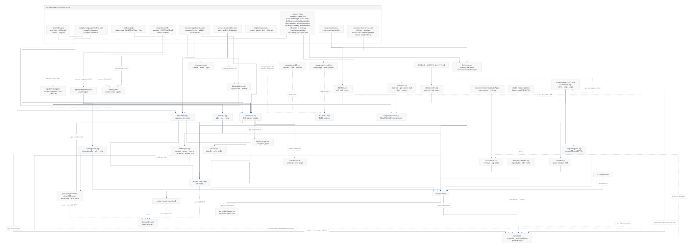

# Architecture

Genlib distributes editable source and isolated integration profiles to an existing application. Its dependency-free CLI and optional direct MCP server share the same discovery, integrity, compatibility and installation functions. Original Apache-2.0 adapters have explicit contracts; external tools, packages, hosted services and data retain their own terms. A catalog result or tool call never grants application authority.

The [focused reuse plan](focused-reuse.md) pauses broad catalog, language and harness expansion. The existing topology remains available; current work prioritizes accurate delivery descriptions, complete handoffs and measured adoption on concrete application tasks. Agents may use a known item directly or skip Genlib when the app's existing code or libraries already fit.

## System overview

<picture>
  <source media="(prefers-color-scheme: dark)" srcset="diagrams/architecture-dark.svg">
  
</picture>

Diagram source (Mermaid: edit this, then run <code>npm run diagrams:render</code>)

```mermaid
flowchart TB
  subgraph Authored["Authored sources (reviewed in Git)"]
    MOD["modules/{id}/<br/>module.json · CONTRACT.md · files/"]
    REC["resources/agent-recipes.json<br/>examples/recipes · utilities<br/>storefront · ui"]
    LANG["examples/languages/modules.json<br/>examples/languages<br/>examples/cookbook"]
    CAP["resources/capabilities.json<br/>task → code in 9 languages"]
    TPL["templates/index.json<br/>project · github · docs · ship · ui"]
    TOOLIDX["tools/index.json<br/>repo-map · AST graph<br/>context · diagram"]
    RES["resources/*.json<br/>resources/catalog/*.json<br/>(incl. marketing-*, social-media,<br/>dashboards, scheduling-calendar,<br/>chat-messaging, open-source-tools,<br/>finance-accounting, business-tools,<br/>education, ai-learning,<br/>mapping-navigation)<br/>resources/project-types.json"]
    SKL["resources/skills.json<br/>1,066 pinned agent skills"]
    IDX["resources/mcp-servers.json<br/>clis.json · apis.json<br/>starters.json · task-recipes.json<br/>ranked install indexes"]
    INTEG["integrations/{id}/<br/>manifest · CONTRACT.md<br/>source · fixtures"]
  end
  REG["registry/catalog.json<br/>registry/manifests/*.json<br/>(SHA-256)"]
  INTREG["registry/integrations.json<br/>pack integrity"]
  INTLIB["lib/integrations.mjs<br/>integration plan · add · verify"]
  SHAD["registry.json<br/>shadcn-format registry"]
  SDKMCP["packages/genlib-mcp<br/>direct SDK server<br/>scoped root · write opt-in"]
  HEALTH["lib/catalog-health.mjs<br/>deps.dev · OSV · endoflife"]
  CHK["catalog-health workflow<br/>daily sample · weekly install"]
  DISC["lib/discover.mjs<br/>find · detect · catalog"]
  CAPLIB["lib/capabilities.mjs<br/>capability list · inspect"]
  SKLIB["lib/skills.mjs<br/>skill find · inspect"]
  IDXLIB["lib/indexes.mjs<br/>mcp · cli · api · starter · task<br/>find · inspect"]
  RESLIB["lib/resources.mjs<br/>validate · search · types"]
  DOCS_MD["README · AGENTS · docs/**/*.md"]
  DOCIDX["lib/docs-index.mjs<br/>sections + line ranges"]
  JEV["lib/jev.mjs<br/>bounded yes/no packet"]
  SIDX["registry/search-index.jsonl"]
  BRIEF["lib/brief.mjs<br/>quick · compact find"]
  CLI["bin/genlib.mjs"]
  OUTL["lib/outline.mjs<br/>signatures, not source"]
  SRC["lib/source.mjs<br/>pinned fetch plan<br/>+ resources/equivalents.json"]
  MCPS["bin/genlib-mcp.mjs<br/>MCP tools"]
  TOK["docs/token-budget.md<br/>measured output sizes"]
  INST["lib/install.mjs<br/>plan · add · verify"]
  APP["Target app<br/>src/genlib/ · .genlib/lock.json<br/>.genlib/receipts/"]
  LIFE["lib/lifecycle.mjs<br/>adopted · update · remove<br/>+ schemas/*.schema.json"]
  CONTRACTS["resources/feature-contracts/*.json<br/>requirements + evidence"]
  COV["lib/coverage.mjs<br/>coverage · gap report"]
  REGIN["lib/registry-adapter.mjs<br/>registry plan · add · verify"]
  EXTREG["shadcn-format registries<br/>(https, pinned SHA-256)"]
  PROV["resources/providers/*.json<br/>lib/providers.mjs<br/>check · staged adopt"]
  NET["Git hosts · npm<br/>PyPI · crates.io"]
  DOCS["scripts/sync-docs.mjs<br/>README and resource counts"]
  DIAG["scripts/diagrams.mjs<br/>Agentic Mermaid SVGs"]
  JEVX["Genisys Jev and<br/>other harnesses"]
  GRAPH["registry/graph.json<br/>navigation graph"]
  VAULT["Obsidian vault<br/>(generated notes only)"]
  SKILL["skills/genlib-use"]
  HARN["lib/harnesses.mjs<br/>native configuration profiles"]
  SKINSTALL["install-skills.mjs<br/>scoped safe skill copy"]
  DOCTOR["harness-doctor.mjs<br/>read-only protocol checks"]
  MOD -- "npm run registry:build" --> REG
  INTEG -- "npm run integrations:build" --> INTREG --> DISC
  INTREG --> INTLIB --> CLI
  INTLIB --> SDKMCP -. "stdio · Streamable HTTP" .-> JEVX
  INTLIB -- "copies reviewed bytes" --> APP
  MOD & REC -- "npm run shadcn:build" --> SHAD
  SHAD -. "npx shadcn add athompson83/genlib/{item}" .-> APP
  HEALTH -. "maintainers" .-> NET
  REG --> DISC
  REC --> DISC
  LANG --> DISC
  CAP --> CAPLIB --> DISC
  LANG -. "language-modules add" .-> CAPLIB
  TPL --> DISC
  TOOLIDX --> DISC
  SKL --> SKLIB --> DISC
  IDX --> IDXLIB --> DISC
  RES --> RESLIB --> DISC
  DOCS_MD --> DOCIDX --> DISC
  DISC --> JEV --> CLI
  DISC -- "npm run index:build" --> SIDX
  DISC --> BRIEF --> CLI
  CAP & LANG & REC & REG --> OUTL --> CLI
  OUTL & BRIEF --> MCPS
  RES & SKL & IDX --> SRC --> CLI
  SRC --> MCPS
  CLI -- "npm run tokens:report" --> TOK
  REG --> INST --> CLI
  CLI -- "copies reviewed bytes" --> APP
  INST --> LIFE --> CLI
  LIFE -- "receipts · 3-way merge · rollback" --> APP
  CONTRACTS --> COV --> CLI
  COV --> MCPS
  APP -. "acceptance in receipts" .-> COV
  EXTREG -. "fetch" .-> REGIN --> CLI
  REGIN -- "providers-lock · receipts" --> APP
  PROV --> DISC
  PROV --> CLI
  PROV -- "prerequisite checks · new files only" --> APP
  SKLIB -. "npx skills add (pinned)" .-> APP
  IDXLIB -. "mcp add · brew · SDK" .-> APP
  RES -. "verify-resources.mjs<br/>(network, maintainers)" .-> NET
  RES -.-> CHK -. "rotating sample" .-> NET
  REG & RES --> DOCS
  DOCS_MD -. "npm run diagrams:render" .-> DIAG
  SIDX -. "grep / own retrieval" .-> JEVX
  DISC --> MCPS -. "stdio JSON-RPC" .-> JEVX
  DISC -- "npm run graph:build" --> GRAPH
  DISC -- "export-obsidian.mjs" --> VAULT
  JEV -. "genlib jev --json" .-> JEVX
  SKILL -- "routes agents to" --> CLI
  HARN --> CLI
  HARN -- "native MCP configuration" --> JEVX
  HARN --> SKINSTALL
  SKILL --> SKINSTALL --> JEVX
  CLI --> DOCTOR -. "local stdio smoke calls" .-> SDKMCP
  DOCTOR -. "discovery smoke calls" .-> MCPS
```

Every arrow into the target app goes through `plan`/`add` (modules), `integration plan`/`add` (packs), the recipe or language installers, the shadcn CLI reading `registry.json`, or a person merging a template. No catalog text, package hook or maintainer network response executes automatically. The MCP servers adapt these functions to a protocol; they do not shell out to perform tool requests.

## Discovery and delivery

1. Authors maintain `modules/<id>/module.json`, `CONTRACT.md`, and `files/`.
2. `npm run registry:build` emits a compact `registry/catalog.json` and detailed manifests with SHA-256 file hashes. `registry:check` checks freshness without changing files.
3. `npm run integrations:build` creates `registry/integrations.json` from pack manifests, contracts and source. Binding checks require canonical external resource IDs and resolvable Genlib module and pack references.
4. When discovery is useful, agents run `quick` (best match and its commands) or `find` (compact list; `--json` for full records). A known item can go directly to its contract and installation plan. Public signatures, delivery caveats and targeted source reads support the integration decision. Discovery applies the lifecycle and license policy (retired records hidden unless `--include-retired`; `--license-policy permissive`). `find` ranks capabilities, modules, recipes, language examples, templates, navigation tools and resources together, and `detect` reads the target's manifests to mark fit. Agents do not load all module source to make that choice.
5. `plan` resolves exact local module dependencies and checks paths, existing files, and target compatibility without writing.
6. `add` copies verified files to the target's `src/genlib` (or explicit `--out`) and writes provenance to `.genlib/lock.json`; `integration add` copies a pack to `genlib/integrations/<id>` and records it in `.genlib/integrations-lock.json`. License notices accompany the copy. It never runs module hooks or package managers. The language-example and recipe installers record their copies in the same lock (`kind: language|recipe`) through `planCopy`/`installCopy`, so an identical shared file is reused and owned by every capability that needs it, while edited or untracked files still conflict.
7. `verify` compares installed files with their recorded original hashes. A deliberate edit is reported as modified; this is not an application correctness test.
8. `add` also writes `.genlib/receipts/<id>.json`. `adopted <id>` marks it used when application code imports the installed files and verified when the app's own test command passes; `update <id>` three-way merges a newer version into local edits using the locked commit as the base (dry run unless `--write`); `remove <id>` rolls back unedited files. These live in `lib/lifecycle.mjs`, and their JSON shapes are in `schemas/`.
9. `coverage <task>` reads `resources/feature-contracts/` and reports each requirement of a feature at its best evidence status, from `cataloged` to `fixture-verified` (a named repository test, checked by `npm run contracts:check`) and `application-verified` (acceptance recorded in the app's receipt by `adopted --accepts`). `registry plan|add` adopts shadcn-format registry items into the app with the same plan, conflict, lock and receipt rules, recorded in `.genlib/providers-lock.json`. `provider check|adopt` does the same for an upstream feature profile: offline prerequisite checks, then adoption of a scaffolder's output from a scratch copy, new files only ([providers.md](providers.md)).

The core CLI uses Node.js built-ins and works from a trusted local clone without installing npm packages. Each optional integration and the MCP server has isolated pinned dependencies. They do not become core runtime dependencies.

The module handoff returned by `plan` and `add` comes from the contract's `Integration points` code block. Import paths include selected dependency files and follow a custom output directory. For `data-table`, this includes the component and both required stylesheets. The app still supplies data, mounts the component and runs its own checks; installation does not invent or execute an application test command.

## Direct MCP transport

`packages/genlib-mcp/server.mjs` uses the official SDK for stdio and Streamable HTTP, serving current and legacy stateless clients through one server factory. It exposes compact quick/find/outline tools, bounded metadata/contracts and declared-file reads, Jev packets, scoped project detection, planning and baseline verification. Startup `--allow-install` plus `--project-root` is required to register the write tool. Compact tools reuse the CLI's ranking, caveats and formatters; project access uses the configured root.

HTTP defaults to loopback. A non-loopback bind requires a bearer token and exact allowed hosts; Origin-bearing requests need an exact allowed origin. HTTP bodies/tool results are bounded; paths are scoped before shared library calls. The private token mode is a single trust boundary, not a multi-user OAuth system. Deployment, TLS and per-tenant process isolation belong to the host. See [MCP connection and access](mcp-server.md) and the SDK-client transport tests.

## Integration pack profiles

Packs cover web features, contract generation, codemods, native acceptance/persistence, Rust bindings, desktop delivery, authorization/collaboration, typed backend services and observability. Manifests list exact delivered files and resource bindings. `verification.profiles` describes environments actually exercised; unavailable native or service-backed acceptance stays experimental. The [integration guide](integrations.md) describes compatibility, provenance, safe copying and version updates.

## Integration boundaries

Keep reusable behavior configurable through props, design variables, and injected adapters. Read the chosen module contract for imports, peers, client/server boundaries, and remaining application responsibilities. A preview, checksum, or successful copy does not prove that authentication, authorization, persistence, accessibility, or business behavior works in the receiving app.

Framework checks deliberately recognize a small set of React 18/19 declarations. Ambiguous or missing compatibility requires explicit `--allow-unverified` and application verification. A recognized incompatible version remains an error. No operation grants service credentials or application permissions.

Framework-neutral server modules do not require React. Their platform and runtime requirements are recorded in the contract; the installer cannot prove that a receiving build keeps them out of a browser bundle. The receiving application must enforce that server boundary. Provider adapters accept credentials and application authorization through explicit callbacks, bound each HTTP request, and leave account setup, OAuth, persistence, budgets and live acceptance to that application.

## External resources and project templates

`resources/attachments.json`, `resources/ui-foundations.json` and every domain file under `resources/catalog/` form a separate source-discovery catalog of external projects, services and references, tagged with the project types in `resources/project-types.json`. `tools/resources.mjs` validates those records offline and returns bounded, filtered metadata without downloading or executing external code. Each record identifies its license scope, primary evidence, cautions, related guide and any original Genlib adapter. `scripts/verify-resources.mjs` is a maintainer-run network check of repositories, registry-declared licenses and links; it is not part of the offline test suite. Resource review does not imply a package is installed or its behavior is tested.

`scripts/sync-docs.mjs` regenerates the marked count and catalog tables in the README and resource index from the catalogs, and `npm run check` fails when they are stale.

The module registry currently accepts only original Apache-2.0 source. External packages, marketplace snippets, assets and reference sites retain their own terms. Adopting third-party source into an application requires appropriate provenance and notices; distributing it as a Genlib module would first require an explicit registry provenance/license design change.

`templates/project`, `templates/github`, `templates/docs`, `templates/ship` and `templates/ui` are opt-in project starters indexed by `templates/index.json`. They are not installer hooks and do not change live GitHub settings. A consuming project merges selected files, replaces placeholders and supplies real verification commands before adoption.

## Generated catalogs and agent access

The capability index (`resources/capabilities.json`) maps common tasks to tested code in 9 languages; see [capabilities.md](capabilities.md). Several resource catalogs are generated from verified registry research rather than written by hand, and carry `languages` and registry `popularity`:

- `resources/catalog/marketing-*.json`
- `social-media.json`
- `dashboards.json`
- `scheduling-calendar.json`
- `chat-messaging.json`
- `open-source-tools*.json` (records list the proprietary products they replace, searchable as "<product> alternative")
- `finance-accounting.json` (budgeting, accounting, ledgers, payments, money types, market data)
- `business-tools.json` (BI, BaaS, PaaS, CRM, ERP, helpdesk, documents and business-service SDKs)
- `education.json` (LMSs with their SCORM/LTI/H5P/xAPI support, whiteboards, slides, writing, assessment)
- `ai-learning.json` (agent frameworks and tools such as browser-use, OpenViking, Flowise and Fabric, plus learning references such as TheAlgorithms and System Design Primer, and diagram tools for agents such as Agentic Mermaid and drawio-skill)
- `mapping-navigation.json` (map libraries, mobile SDKs, navigation apps, routing, tile and geo servers, geocoding, OpenStreetMap tooling, geo-processing libraries and desktop GIS, plus the tools, APIs and live data feeds used by God's Eye View)

Each has a guide under `docs/resources/`.

Agents reach everything through one ranking (`lib/discover.mjs`): rarity-weighted matches on stemmed labels and terms, a reviewed synonym table, and a small prior that lets Genlib's own tested code (capabilities, modules, recipes) outrank the large external indexes on equal evidence.

With a receiving project (`--target`, `--language` or a language named in the query), each result gets a `fit`. A known fit multiplies its score by 1.25, and known mismatches are hidden and counted. The rules:

- A resource's frameworks come from what it installs: its `frameworkPackages` adapters (TanStack Table in a Svelte app emits `npm install @tanstack/svelte-table`), else framework names in its package names (`react-facebook-pixel` is React-only), else its tags. A library for another framework does not fit, and React modules do not fit non-JavaScript projects. `quick` keeps a `review` fit and offers `plan` instead of `add`.
- Packages and copied source must match the app's language. Applications and services that run beside the app may be written in any language.
- An API is shown with only the install steps for the project's language. For other languages it points at a same-provider SDK package from the catalog, such as `stripe-go-go`.
- Package records that name the same single package (88 duplicates, such as `discord-js` and `discord-js-npm`) surface once, under a canonical record chosen by `canonicalPackages()`. The stricter integration mode wins, so a license-review flag is never dropped, then the more complete record. The canonical record lists its `aliases` and keeps their project types, platforms, tags and cautions, so a duplicate's classification is never lost. Inspecting an alias id returns the canonical record (`requested`, `canonical`).
- MCP servers are matched by server name and repository rather than the shared `io.github` namespace. One published by the vendor named in the query gets a 1.5× boost. `scripts/routing-eval.mjs` measures how often one `quick` call picks the right capability on 220 task phrasings, 166 of them held out from tuning, and `tests/routing.test.mjs` keeps it from regressing. The paths are:
- **CLI:** `bin/genlib.mjs`.
- **Dependency-free MCP discovery:** `bin/genlib-mcp.mjs`.
- **Direct SDK MCP, scoped project operations and HTTP:** `packages/genlib-mcp/server.mjs`.
- **Jev decision packets:** `lib/jev.mjs`.
- **Generated search index:** `registry/search-index.jsonl`.
- **Navigation graph:** `registry/graph.json`.
- **Obsidian vault export:** `scripts/export-obsidian.mjs`.

`lib/docs-index.mjs` makes every documentation section searchable with its line range. See [agent-access.md](agent-access.md) and [jev.md](jev.md). `npm run check` fails when the index, graph or generated docs are stale.

## Trust and ownership

Trust a reviewed repository revision before executing its CLI. Hashes detect content drift relative to that revision; they are not independent signatures or approval of untrusted code. Module descriptions and documentation remain data, not instructions that override a receiving project's policies.

The installers reject traversal, source/destination symlinks, conflicting files, invalid manifests, and checksum mismatches. A cooperating installer lock serializes Genlib writes per target. Preflight catches conflicts before copying. Integration installation writes a bounded recovery journal before publishing source, retains published files after a failure, and reports an incomplete transaction for deliberate reconciliation. It never races an editor by deleting a published file during cleanup. The independent module installer retains its existing rollback behavior. These checks cannot sandbox a hostile process with the same filesystem privileges. A process crash can leave a stale write lock and untracked source; inspect the recovery evidence and project files explicitly before retrying.

Genlib keeps original module and pack hashes so customized source is never silently overwritten by a future installation. Updates require review of upstream and local changes. There is no force-overwrite or automatic-upgrade operation.

Public modules must be original contributions authorized for Apache-2.0 distribution with accurate provenance. Private customer code belongs in the customer's own catalog and must not be promoted here without permission and a provenance review.

## Harness support

`skills/genlib-use` is canonical. Generated repository mirrors live under `.agents/skills` and `.claude/skills`. `lib/harnesses.mjs` records documented MCP formats and skill paths for OpenClaw, Hermes, Antigravity, VS Code, Cursor, OpenCode, Claude Code, Codex, Cline, Roo and generic hosts. `genlib harness config` emits a native configuration fragment and setup metadata without changing host settings. The Ollama profile explicitly delegates skill and MCP execution to OpenCode; Ollama provides the model.

`harness install` uses the existing skill installer, preflights every unique destination and copies only its own complete skill folder. Project scope is the default; personal scope requires an explicit home-directory target. Shared destinations are deduplicated, existing instructions and customizations are preserved, and repository mirrors remain generated from the canonical skill.

`lib/harness-doctor.mjs` launches only the selected fixed local Genlib entry point with Node, negotiates MCP, lists tools and performs bounded read-only calls. It uses no shell, installs no dependencies, and always closes the child process. It verifies the server-side protocol path, not a desktop application's configuration or a remote endpoint. Protocol, documented configuration and actual client acceptance remain separate evidence. See [harness setup](harnesses.md).

## Measurement

Measure actual input/output/cached tokens, model cost, repair cycles, elapsed time, and accepted feature behavior against the existing library-aware build process. Include curation and maintenance effort. No model call or paid service is necessary to use Genlib itself.

The [comparison protocol](benchmarks.md#comparison-protocol) defines a four-arm measurement against an agent that already has upstream tools. Rounds 4–5 ran that comparison on backend features, and later rounds tested interventions on recurring tasks; the report documents their scope and limitations. Where final model output usage is unavailable, the canonical cost proxy uses estimated full written output and labels it as an estimate. A new receiving-application comparison for the focused reuse work remains pending; deterministic installation and DOM fixtures do not satisfy the economic gate. [landscape.md](landscape.md) records comparable projects, and [distribution.md](distribution.md) the checked shadcn, Skills, APM and Context7 routes.

The [retrieval evaluation](retrieval-evaluation.md) measures task recall and serialized context size without making a model-token savings claim. The [catalog health workflow](catalog-health.md) inventories exact locked versions offline and optionally caches bounded upstream dependency/advisory/lifecycle metadata. Neither workflow adds network requests to normal discovery.
