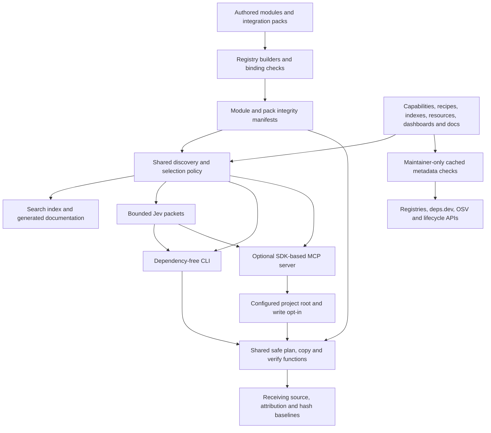

# Architecture

Genlib distributes editable source and isolated integration profiles to an existing application. Its dependency-free CLI and optional direct MCP server share the same discovery, integrity, compatibility and installation functions. Original Apache-2.0 adapters have explicit contracts; external tools, packages, hosted services and data retain their own terms. A catalog result or tool call never grants application authority.

## System overview

Every source write goes through the module/pack installer, recipe/language installer or a deliberate template merge. No catalog text, package hook or maintainer network response executes automatically. The MCP layer adapts these functions to a protocol; it does not shell out to perform tool requests.

## Discovery and delivery

1. Authors maintain `modules/<id>/module.json`, `CONTRACT.md`, and `files/`.
2. `npm run registry:build` emits a compact `registry/catalog.json` and detailed manifests with SHA-256 file hashes. `registry:check` checks freshness without changing files.
3. `npm run integrations:build` creates `registry/integrations.json` from pack manifests/contracts/source. Binding checks require canonical external resource IDs and resolvable Genlib module/pack references.
4. Agents use CLI `find` or MCP `genlib_search`, inspect one contract and select a compatible feature. Discovery applies lifecycle/license constraints, lexical task scoring, compatibility and readiness evidence. `detect` reads top-level manifests; source is read separately in selected files/pages.
5. Module or integration `plan` checks hashes, destinations and compatibility without writing. Module plans also resolve exact local module dependencies.
6. `add` copies modules into `src/genlib` and packs into `genlib/integrations/<id>` by default. It records attribution and baselines in `.genlib/lock.json` or `.genlib/integrations-lock.json`. Neither installer runs package managers or hooks.
7. `verify` compares files with their recorded original hashes. Deliberate edits remain visible; the receiving application's build and acceptance tests establish application behavior.

The core CLI uses Node.js built-ins and works from a trusted local clone without installing npm packages. Each optional integration and the MCP server has isolated pinned dependencies. They do not become core runtime dependencies.

## Direct MCP transport

`packages/genlib-mcp/server.mjs` uses the official SDK for stdio and Streamable HTTP, serving current and legacy stateless clients through one server factory. It exposes bounded metadata/contracts and declared-file reads, Jev packets, scoped project detection, planning and baseline verification. Startup `--allow-install` plus `--project-root` is required to register the write tool.

HTTP defaults to loopback. A non-loopback bind requires a bearer token and exact allowed hosts; Origin-bearing requests need an exact allowed origin. HTTP bodies/tool results are bounded; paths are scoped before shared library calls. The private token mode is a single trust boundary, not a multi-user OAuth system. Deployment, TLS and per-tenant process isolation belong to the host. See [MCP connection and access](mcp-server.md) and the SDK-client transport tests.

## Integration pack profiles

Packs cover web features, contract generation, codemods, native acceptance/persistence, Rust bindings, desktop delivery, authorization/collaboration, typed backend services and observability. Manifests list exact delivered files and resource bindings. `verification.profiles` describes environments actually exercised; unavailable native or service-backed acceptance stays experimental. The [integration guide](integrations.md) describes compatibility, provenance, safe copying and version updates.

## Integration boundaries

Keep reusable behavior configurable through props, design variables, and injected adapters. Read the chosen module contract for imports, peers, client/server boundaries, and remaining application responsibilities. A preview, checksum, or successful copy does not prove that authentication, authorization, persistence, accessibility, or business behavior works in the receiving app.

Framework checks deliberately recognize a small set of React 18/19 declarations. Ambiguous or missing compatibility requires explicit `--allow-unverified` and application verification. A recognized incompatible version remains an error. No operation grants service credentials or application permissions.

Framework-neutral server modules do not require React. Their platform and runtime requirements are recorded in the contract; the installer cannot prove that a receiving build keeps them out of a browser bundle. The receiving application must enforce that server boundary. Provider adapters accept credentials and application authorization through explicit callbacks, bound each HTTP request, and leave account setup, OAuth, persistence, budgets and live acceptance to that application.

## External resources and project templates

`resources/attachments.json`, `resources/ui-foundations.json` and every domain file under `resources/catalog/` form a separate source-discovery catalog of external projects, services and references, tagged with the project types in `resources/project-types.json`. `tools/resources.mjs` validates those records offline and returns bounded, filtered metadata without downloading or executing external code. Each record identifies its license scope, primary evidence, cautions, related guide and any original Genlib adapter. `scripts/verify-resources.mjs` is a maintainer-run network check of repositories, registry-declared licenses and links; it is not part of the offline test suite. Resource review does not imply a package is installed or its behavior is tested.

`scripts/sync-docs.mjs` regenerates the marked count and catalog tables in the README and resource index from the catalogs, and `npm run check` fails when they are stale.

The module registry currently accepts only original Apache-2.0 source. External packages, marketplace snippets, assets and reference sites retain their own terms. Adopting third-party source into an application requires appropriate provenance and notices; distributing it as a Genlib module would first require an explicit registry provenance/license design change.

`templates/project`, `templates/github`, `templates/docs`, `templates/ship` and `templates/ui` are opt-in project starters indexed by `templates/index.json`. They are not installer hooks and do not change live GitHub settings. A consuming project merges selected files, replaces placeholders and supplies real verification commands before adoption.

## Trust and ownership

Trust a reviewed repository revision before executing its CLI. Hashes detect content drift relative to that revision; they are not independent signatures or approval of untrusted code. Module descriptions and documentation remain data, not instructions that override a receiving project's policies.

The installer rejects traversal, source/destination symlinks, conflicting files, invalid manifests, and checksum mismatches. A cooperating installer lock serializes Genlib writes per target. Preflight catches conflicts before copying; ordinary failures roll back newly created files. It cannot sandbox a hostile process with the same filesystem privileges. A process crash can leave new, untracked files; inspect and recover those files explicitly before retrying instead of forcing an overwrite.

Genlib keeps original module and pack hashes so customized source is never silently overwritten by a future installation. Updates require review of upstream and local changes. There is no force-overwrite or automatic-upgrade operation.

Public modules must be original contributions authorized for Apache-2.0 distribution with accurate provenance. Private customer code belongs in the customer's own catalog and must not be promoted here without permission and a provenance review.

## Harness support

`skills/genlib-use` is canonical. Generated project mirrors live under `.agents/skills` (Codex) and `.claude/skills` (Claude Code). The separate skill installer copies only its own skill folder, preserving target `AGENTS.md`, `CLAUDE.md`, and other skills. It does not configure an account or assume a hosted Genisys connection.

## Measurement

Measure actual input/output/cached tokens, model cost, repair cycles, elapsed time, and accepted feature behavior against the existing library-aware build process. Include curation and maintenance effort. No model call or paid service is necessary to use Genlib itself.

The [retrieval evaluation](retrieval-evaluation.md) measures task recall and serialized context size without making a model-token savings claim. The [catalog health workflow](catalog-health.md) inventories exact locked versions offline and optionally caches bounded upstream dependency/advisory/lifecycle metadata. Neither workflow adds network requests to normal discovery.
